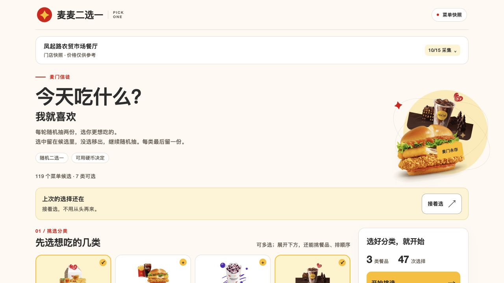
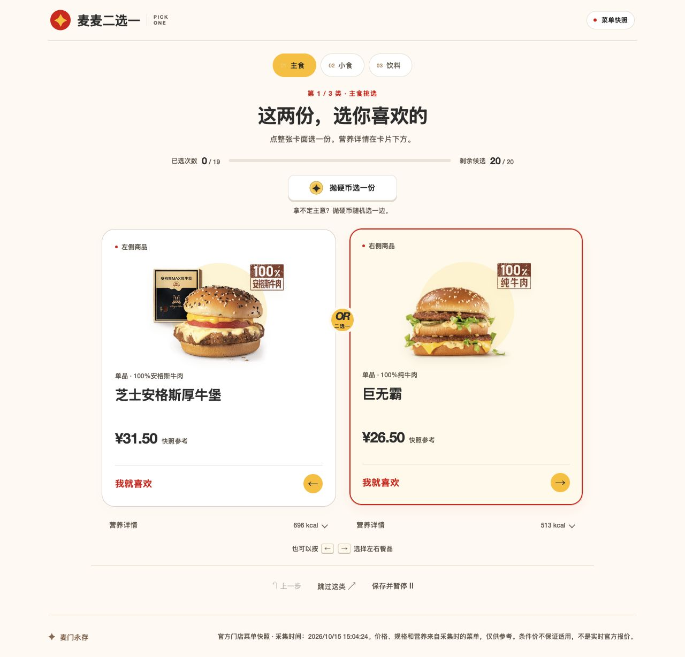
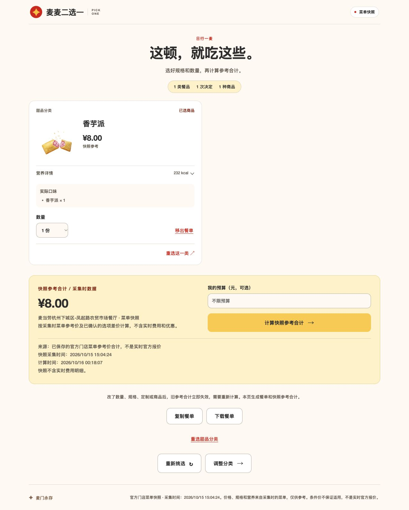
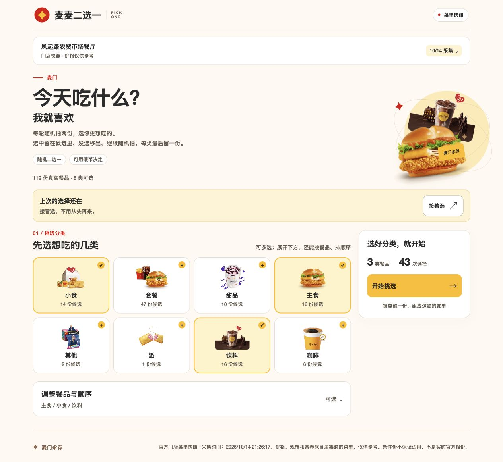
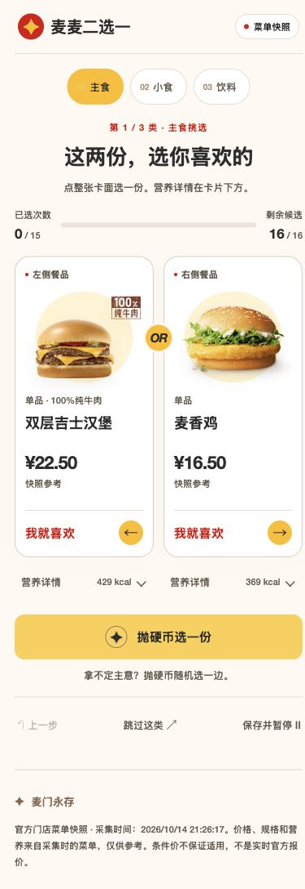

<div align="center">

# 麦麦二选一

**每轮两份，选你更想吃的。先选餐品，再看这顿多少钱。**

[免 Token 试玩](https://roooooooooy.github.io/mcd-food-arena/) · [看看怎么玩](#怎么玩) · [本人优惠券与核价](#本人优惠券与官方核价) · [本机启动](#本机启动)

</div>

## 界面示例



<table>
  <tr>
    <th width="50%">随机二选一：主食示例</th>
    <th width="50%">最终餐单：甜品示例</th>
  </tr>
  <tr>
    <td width="50%" valign="top"></td>
    <td width="50%" valign="top"></td>
  </tr>
</table>

图中是免 Token 的公网试玩，使用 **2026-10-15 15:04:24（北京时间）**采集的凤起路农贸市场餐厅菜单：119 个候选、7 个分类、118 张官方原图。价格、规格、选项和营养只参考采集时的数据；本人查券和官方核价在本机账号版使用。

## 怎么玩

适合不知道吃什么、想先选餐品再看整单价格的用户。

1. **圈选想吃的。** 分类可多选，还能挑候选、拖动左侧手柄排顺序；上下箭头也能调整。
2. **每轮只选一边。** 从存活候选里随机抽两份，选中的留池，另一份淘汰，再重新抽一对。N 份候选需要 N−1 次选择，同一份可能多次上场。
3. **犹豫就抛硬币。** 也可以点击整张卡面，或按 Enter、空格、左右方向键选择。营养详情在卡片下方独立展开。
4. **最后整理这顿餐单。** 每类留一份，可改数量、杯型、定制，移出餐品或返回分类重选。支持上一步、跳过和暂存。

派归甜品，菠萝派、香芋派、新地和经典麦旋风等实际口味分别参与选择；“其他”保留周边。同味饮料先作为一个候选，最后再选杯型。口味与定制的图文记录见 [验证记录](docs/menu-options-verification.md)。

分类拖动时只预览，松手生效；Esc 或列表外松手取消，已选餐品保持。键盘可用空格拿起、上下移动，再用空格或 Enter 放下，详见 [分类拖拽记录](docs/drag-order-verification.md)。

## 本人优惠券与官方核价

在本机连接自己的麦当劳账号，就能查本人券包、看相关券、按餐品编码与数量比较替换方案。先看券能替换哪些餐品，再核对官方金额；可以应用，也可以撤销。

**一次本机真实调用记录（2026-10-15）：**

| 这次怎么选 | 实际结果 |
| --- | --- |
| 已选餐品 | 巨无霸、薯条、菠萝派 |
| 本人券包 | 8 张，其中 2 张当时可用于当前门店 |
| 匹配方案 | “王牌小食拼”，覆盖 2/3（67%） |
| 官方整单比价 | ¥48.50 → ¥42.40 |
| 应用与撤销 | 应用保留巨无霸；撤销恢复原餐品 |

重新应用后，21:17:32（北京时间）取得官方整单 ¥42.40。以上是当次券资格与报价，当前金额仍需重新核价，详见 [账号验收](docs/commerce-verification.md)。

“定制餐品”默认折叠，可按门店实际选项调冰量、选配料、换燕麦奶或修改套餐搭配。同一套餐内同种子项的多份数量共用定制，营养按默认配方参考。缺少必选项或定制内容未确认时，不猜参数。

本机版还会显示门店菜单、选项或券的返回状态及检查时间。确认未返回的餐品灰显、不能选入；结果保留已选记录并提示更换。官方暂未提供精确库存或售罄原因，所以不会把菜单缺席直接叫“售罄”。

改餐品、数量、规格或定制，报价过期，或刷新可用状态，都会清除旧报价与用券价差。未知或失败不填零，晚到响应不会恢复旧金额。快照试玩只计算“快照参考合计”：未知价拒绝计算，条件价保留适用说明。

### 下单前，单独确认

本机版支持核对最新官方金额和取餐方式后，明确确认创建待支付订单；支付在返回的官方页面完成。订单结果未确认时，先到官方 App 查看，避免重复下单。

创建及查询订单已有代码和假外部接口测试，**尚未创建、支付或取消任何真实订单**。相关边界见 [技术验收](docs/commerce-verification.md)。

## 本机启动

需要 Node.js 24，本机验证版本为 24.21.0。无需云端托管或注册 Render。

```bash
git clone https://github.com/Roooooooooy/mcd-food-arena.git
cd mcd-food-arena
npm --userconfig=/dev/null ci --include=dev
npm --userconfig=/dev/null run build:commerce
npm --userconfig=/dev/null start
```

构建需要 Vite 等开发依赖，安装时保留 `--include=dev`。服务只监听本机 `127.0.0.1:8788`，网页与 API 共用这一个服务。

打开 `http://127.0.0.1:8788`，展开页头“连接账号”，粘贴从[麦当劳官方](https://open.mcd.cn/mcp)获取的本人 Token。连接后自动读取真实门店菜单与本人券包，也可以先试玩门店快照。测试门店为已核实的 `3330251`：杭州建国北路286号凤起路农贸市场餐厅，到店自提。完整运行方式见 [本机运行说明](docs/commerce-deployment.md)。

Token 提交后输入框立即清空，不写浏览器存储，仅在本机服务的内存会话中使用。默认有效期 30 分钟，断开、过期或服务重启后需重新连接。每个账号的菜单、券包、报价和订单状态相互隔离，没有项目所有者 Token 后备。

<details>
<summary>暂存、恢复与开发运行方式</summary>

暂存只保存菜单上下文、分类、候选 ID、实际对阵与决定，恢复保留原对阵和候选池。重新明确加载真实菜单后，相同内容可以继续；门店、商品、规格或价格变化时，需要重新选择分类。旧版规则存档会提示重新开始。旧随机回调和晚到报价受独立记录与请求标识保护。

快照的 31 个内部选项包含 18 个饮料规格和 13 个固定食品口味映射。安装依赖后，只运行快照前端可用 `npm --userconfig=/dev/null run dev:web`。

快照开发命令 `dev` 同时启动 `dev:api` 与 `dev:web`，固定监听 `127.0.0.1:8787` 和 `127.0.0.1:5173`。端口占用时不另换端口；一个服务失败会停止另一个，Ctrl+C 清理本次进程树，脚本已在 macOS 验证。Homebrew Node 24 可先执行 `export PATH="/opt/homebrew/opt/node@24/bin:$PATH"`。

旧的 `dev:api` 仍用本机 `MCD_MCP_TOKEN` 配置支持 8787 只读脚本。当前账号服务的 `start` 不读取 `.env.local`，Token 只由本机表单提交，不放进前端构建。

GitHub Pages 构建命令为 `VITE_PUBLIC_DEMO=true VITE_PUBLIC_COMMERCE=false npm --userconfig=/dev/null run build -- --base=/mcd-food-arena/`，只开放快照。本人账号版使用 `build:commerce`，在用户电脑上提供网页、API 和健康检查，不安排公网个人账号服务。

</details>

## 开发与验证

```bash
npm --userconfig=/dev/null test
npm --userconfig=/dev/null run typecheck
npm --userconfig=/dev/null run build
npm --userconfig=/dev/null run check:public
```

界面与手机记录见 [UI 验证](docs/ui-verification.md)，数据来源见 [快照说明](docs/demo.md)，接口与浏览器记录见 [验证记录](docs/live-verification.md)。构建成功和公开部署分别验证。应用不会自动报名，连接账号或取得报价也不会自动下单。

<details>
<summary>历史截图与真实核价记录</summary>

2026-10-15 本机浏览器完成四分类、55 份候选、51 次选择。巨无霸、薯条、中杯可乐和新地各 1 份，在13:00:21（北京时间）取得官方整单 ¥62.50；可乐改为大杯、数量 2 后重新核价为 ¥76.50。暂停恢复、餐盘修改及 390×844 手机页面也已补验。金额只对应当次选择，详见 [本轮浏览器记录](docs/live-verification.md#2026-10-15-真实浏览器补验)。





两张历史图使用10月14日快照，保留当时已发布的界面；当前快照为119候选、7分类。本机账号入口和券流程以本文说明及账号验收为准，10月15日口味拆分的桌面与手机截图见 [口味与定制验证](docs/menu-options-verification.md)。

</details>

## 参赛与接入文档

参赛申请已于 2026-10-16 提交，官方已回复作品成功参赛：[报名记录](https://github.com/M-China/mcd-developer-innovation-challenge/issues/772) · [官方成功回复](https://github.com/M-China/mcd-developer-innovation-challenge/issues/772#issuecomment-6197625082)。

官方原文声明见 [CONTEST_DECLARATION.md](CONTEST_DECLARATION.md)，实际 MCP 工具、调用流程与业务价值见 [MCP_INTEGRATION.md](MCP_INTEGRATION.md)，配置只使用[环境变量占位示例](mcp-config.example.json)。主赛材料对应[报名正文](docs/submission.md)、[材料核对](docs/submission-readiness.md)和[公开清单规则](docs/public-files.md)。
